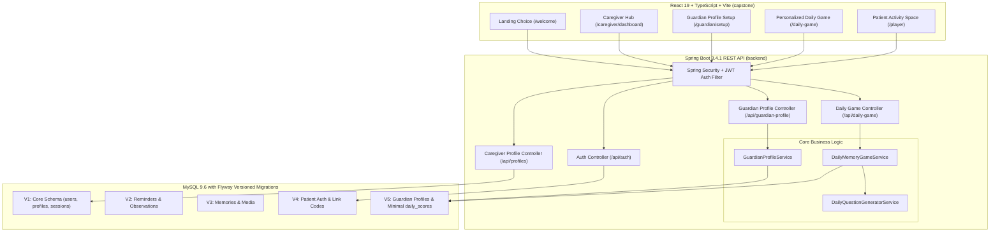

# Neuro Playy — Cognitive Gaming & Memory Assistance Platform
[](https://spring.io/projects/spring-boot)
[](https://react.dev/)
[](https://www.mysql.com/)
[](https://flywaydb.org/)
[](https://vitejs.dev/)

> **Neuro Playy** is an empathetic, clinically considerate, full-stack cognitive stimulation and memory assistance platform. Designed specifically for individuals living with mild cognitive impairment (MCI) or dementia and their dedicated caregivers, Neuro Playy combines targeted neuro-drills with guardian-curated episodic memory reinforcement.

---

## 🏛️ System Architecture



---

## ✨ Key Platform Features

### 1. 🛡️ Caregiver Management Hub
- **Multi-Profile Monitoring**: Manage loved ones with individual preferences (preferred name, text scale, language, audio cues).
- **Adaptive Rhythm Engine**: Dynamic difficulty recommendations based on observed completion rhythm rather than punitive metrics.
- **Patient Link-Code Provisioning**: Generates single-use, 24-hour verification codes for loved ones to register password-less or easy logins.
- **Supportive Reminders & Memory Albums**: Daily hydration, mealtime, and medication reminders alongside reminiscence photo albums.

### 2. 📝 Guardian Profile Setup (`/guardian/setup`)
- **A. Basic Information**: Full name, nickname, date of birth, place of birth, hometown, preferred language, caregiver notes.
- **B. Family & Loved Ones**: Dynamic roster of relatives (spouse, children, grandchildren, siblings, friends) with birthdays and memories.
- **C. Life Milestones**: Important life events (weddings, graduations, military service, career milestones) with approximate dates.
- **D. Custom Memory Trivia**: Specific question-and-answer pairs with 1 correct answer and 3 guardian-provided distractors.

### 3. 🧩 Personalized Daily Memory Game (`/daily-game`)
- **Dynamic Daily MCQ Generation**: Generates 5 personalized multiple-choice questions daily based on guardian facts.
- **4 Distinct Options per Question**: 1 correct answer and 3 contextual distractors generated dynamically.
- **Masked Client Delivery**: Correct answers remain strictly on the server until scoring.
- **Mid-Session Persistence**: Active game sessions persist in `daily_game_sessions` so reloading or navigating does not lose progress.
- **Dignified Feedback**: Non-evaluative, positive reinforcement celebrating connection rather than deficit.

### 4. 🔒 Privacy-Preserving Minimal Score Storage
- The permanent `daily_scores` table strictly stores **only**:
  $$\text{Record} = \{\text{id}, \text{user\_id}, \text{score}, \text{game\_date}\}$$
- No question texts, answer logs, or cognitive drift percentages are stored permanently in the database.
- Historical progress statistics (**Total Games**, **Average Score**, **Best Score**) are derived dynamically on the fly by the service layer.

---

## 🛠️ Technology Stack

### Backend
- **Framework**: Spring Boot 3.4.1 (Java 17 / Java 25 compatible)
- **Security**: Spring Security 6.4 + JJWT (HMAC-SHA384 Token Authentication)
- **ORM / Persistence**: Spring Data JPA & Hibernate 6.6
- **Database Migrations**: Flyway 10.20
- **Validation**: Jakarta Validation API (Hibernate Validator 8.0)
- **Documentation**: SpringDoc OpenAPI 2.8 (Swagger UI)
- **Database**: MySQL 9.6

### Frontend
- **Framework**: React 19 + TypeScript
- **Bundler & Dev Server**: Vite 8.3
- **Styling**: Tailwind CSS
- **3D Interactive Art**: Three.js
- **Icons**: Lucide React
- **Audio Synthesis**: Web Audio API tactile audio engine

---

## 📡 REST API Reference

| Endpoint | Method | Role | Description |
|---|---|---|---|
| `/api/auth/register` | `POST` | Public | Register caregiver or patient account |
| `/api/auth/login` | `POST` | Public | Authenticate user & return JWT token |
| `/api/guardian-profile/status` | `GET` | Authenticated | Check profile completion status & item counts |
| `/api/guardian-profile` | `GET` | Authenticated | Fetch complete guardian profile bundle |
| `/api/guardian-profile` | `PUT` | Authenticated | Save/update guardian profile, relatives, & questions |
| `/api/daily-game/status` | `GET` | Authenticated | Get today's game availability and today's score |
| `/api/daily-game/start` | `POST` | Authenticated | Start or resume today's 5-question daily game |
| `/api/daily-game/answer` | `POST` | Authenticated | Record answer for a question in active session |
| `/api/daily-game/complete` | `POST` | Authenticated | Score session atomically & save to `daily_scores` |
| `/api/daily-game/scores` | `GET` | Authenticated | Get score history & derived statistics |
| `/api/profiles` | `GET` | Caregiver | List managed loved-one profiles |
| `/api/profiles/{id}/summary` | `GET` | Caregiver | Get profile summary and session history |
| `/api/profiles/{id}/patient-login` | `GET` | Caregiver | Get patient account linking status |
| `/api/profiles/{id}/link-code` | `POST` | Caregiver | Generate single-use patient registration code |

---

## 🗄️ Database Migrations (Flyway)

All database schema evolutions are managed version-by-version using Flyway in `backend/src/main/resources/db/migration/`:

```
V1__initial_schema.sql                       # users, player_profiles, game_sessions, cognitive_telemetry
V2__reminders_and_observations.sql           # reminders, observations
V3__memories_and_media.sql                   # memories, media transcripts
V4__patient_auth_and_link_codes.sql          # patient credentials, single-use link codes
V5__guardian_profile_and_daily_memory_game.sql # user_profiles, relatives, life_events, personal_questions, daily_game_sessions, daily_scores
```

---

## 🚀 Quick Start Guide

### Prerequisites
- **Java**: JDK 17 or higher (JDK 21 / 25 supported)
- **Node.js**: v18.0 or higher (v20+ recommended)
- **MySQL**: 8.0 or 9.x running on port `3306`

---

### Step 1: Database Setup
Create the MySQL database:
```sql
CREATE DATABASE IF NOT EXISTS cognitive_platform
    CHARACTER SET utf8mb4
    COLLATE utf8mb4_unicode_ci;
```

Configure credentials in [`backend/src/main/resources/application.yml`](./backend/src/main/resources/application.yml):
```yaml
spring:
  datasource:
    url: jdbc:mysql://localhost:3306/cognitive_platform?useSSL=false&allowPublicKeyRetrieval=true&serverTimezone=UTC
    username: root
    password: YOUR_MYSQL_PASSWORD
```

---

### Step 2: Run the Spring Boot Backend
```bash
cd backend

# Compile and start Spring Boot with Flyway migrations
./mvnw spring-boot:run
```
Backend will start at: **`http://localhost:8080`**  
Swagger API Docs available at: **`http://localhost:8080/swagger-ui.html`**

To run backend integration tests:
```bash
./mvnw test -Dtest=DailyMemoryGameIntegrationTest
```

---

### Step 3: Run the React Frontend
In a new terminal window:
```bash
cd capstone

# Install npm dependencies
npm install

# Start Vite development server
npm run dev
```
Frontend will be live at: **`http://localhost:5173`**

---

## 🎯 Presentation Verification Checklist

1. **Spring Boot Backend**: Open `http://localhost:8080/swagger-ui.html` or inspect `backend/pom.xml` to showcase Spring Boot 3.4.1, JPA Repositories, and REST controllers.
2. **Flyway Migrations**: Run `SHOW TABLES;` in MySQL to demonstrate migrations `V1` through `V5` and the minimal `daily_scores` table.
3. **Caregiver & Guardian Setup**: Navigate to `/caregiver/signup` $\rightarrow$ automatically guides you to `/guardian/setup` to enter family facts.
4. **Daily Memory Game**: Play the personalized 5-question memory game at `/daily-game` and see score history update live on the dashboard.

---

## 📄 License
This project is developed for cognitive health research and educational ideathon presentation. All rights reserved.
